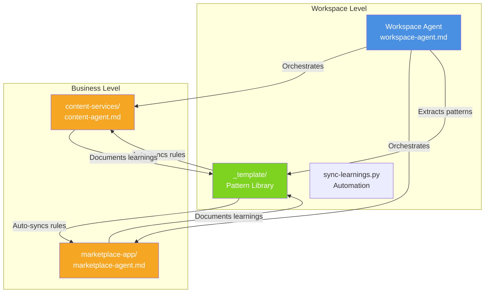

# Multi-Business Workspace Demo

A production-proven hierarchical agent architecture for managing multiple businesses in a single Claude Code workspace.

## Overview

This demo showcases how to use Claude Code's Agent SDK to build a **compound learning system** where patterns discovered in one business automatically benefit all others. Perfect for entrepreneurs managing multiple projects, agencies with multiple clients, or anyone wanting to scale Claude Code across projects.

## The Problem

Managing multiple businesses/projects with Claude Code creates challenges:
- **Context switching overhead**: Each business needs separate setup
- **Duplicate learnings**: Solutions discovered in Project A don't help Project B
- **Manual pattern transfer**: Copy-pasting patterns is error-prone
- **Scalability limits**: Adding new projects takes hours of setup

## The Solution: Hierarchical Agents + Automated Pattern Propagation

This architecture uses three levels:

1. **Workspace Agent** (root level) - Orchestrates across all businesses
2. **Business Agents** (business level) - Domain-specific intelligence
3. **Shared Knowledge** (`_template/`) - Pattern library auto-synced to all businesses

### Key Innovation: Compound Learning

```
Business A discovers pattern
→ Documents in LEARNINGS.md
→ Workspace Agent extracts
→ Creates .claude/rules/ file
→ Syncs to all businesses (automated)
→ All businesses benefit immediately
```

## Real-World Results

**Production Stats (2 businesses, 3 months):**
- ⏱️ **87% time savings**: 4+ hours → 30 minutes for new business setup
- 📈 **17 patterns extracted**: From production use (not theory)
- 🚀 **10x faster implementation**: New businesses inherit all patterns
- 🧠 **2,299 lines of agent code**: Across 3 agents (workspace + 2 businesses)

## Architecture

```
workspace/
├── .claude/
│   └── agents/
│       └── workspace-agent.md          # Orchestrator
├── _template/                          # Pattern library (brain)
│   ├── .claude/rules/                  # Auto-synced patterns
│   ├── PATTERNS_DISCOVERED.md          # 17 documented patterns
│   └── sync-learnings.py               # Automation script
└── businesses/
    ├── content-services/               # Business 1
    │   ├── .claude/agents/content-agent.md
    │   ├── .claude/rules/              # ← Synced from _template
    │   └── LEARNINGS.md                # Pattern discovery
    └── marketplace-app/                # Business 2
        ├── .claude/agents/marketplace-agent.md
        ├── .claude/rules/              # ← Synced from _template
        └── LEARNINGS.md
```

### Agent Hierarchy



## Quick Start

### Prerequisites

- Claude Code installed
- Python 3.8+ (for sync automation)
- Git

### Setup (5 minutes)

```bash
# 1. Clone this demo
git clone <this-repo> my-workspace
cd my-workspace

# 2. Sync patterns to all businesses
python _template/sync-learnings.py --verbose

# 3. Start using agents
@workspace-agent "audit ecosystem"
```

### Creating Your First Business

```bash
# Use workspace agent to create from template
@workspace-agent "create new business from saas-platform template named my-app"

# Agent will:
# 1. Copy _template/templates/saas-platform/ → businesses/my-app/
# 2. Sync all 17 patterns automatically
# 3. Create business-specific agent
# 4. Set up LEARNINGS.md

# Time: ~30 seconds (vs 4+ hours manual)
```

## How It Works

### 1. Pattern Discovery

Business agents discover patterns through real work:

```markdown
# businesses/content-services/LEARNINGS.md

## Pattern: LRU Cache for External APIs
**Value:** HIGH
**Problem:** API rate limits + slow responses
**Solution:** Native Map-based LRU cache (100 items, 15min TTL)
**Impact:** 90% fewer API calls, faster UX
```

### 2. Pattern Extraction

Workspace agent extracts generalizable patterns:

```bash
@workspace-agent "extract patterns from content-services"

# Agent:
# - Reads LEARNINGS.md
# - Identifies HIGH/MEDIUM value patterns
# - Creates _template/.claude/rules/native-lru-cache-for-external-apis.md
# - Updates PATTERNS_DISCOVERED.md
```

### 3. Automated Propagation

`sync-learnings.py` distributes patterns to all businesses:

```bash
python _template/sync-learnings.py --verbose

# Output:
# ✅ Synced 17 patterns to 2 businesses
# ✅ Created audit trail: _template/audit/sync_2026-03-08.json
```

### 4. Automatic Benefit

All businesses now use the pattern:

```bash
cd businesses/marketplace-app
@marketplace-agent "implement API caching for driver lookups"

# Agent automatically applies LRU cache pattern (loaded from .claude/rules/)
```

## Key Patterns Included

### HIGH Value Patterns (3)

1. **Two-PC Continuity System**
   - Problem: Work across multiple machines loses context
   - Solution: Git-based memory (MEMORY.md, SPRINT_LOG.md, CHRONICLE.md)
   - Impact: Zero context-switch overhead

2. **Autonomous Agent Decision Framework**
   - Problem: Agents hesitate on safe operations
   - Solution: Clear boundaries (reversible = autonomous, irreversible = ask)
   - Impact: Faster autonomous work, 147→122 files (-17%) in one business

3. **Hybrid Agent Architecture**
   - Problem: Single agent per business OR one agent for all
   - Solution: Both - workspace orchestrator + business specialists
   - Impact: Centralized learning + domain expertise

### MEDIUM Value Patterns (8)

4. **Native LRU Cache for External APIs**
5. **Trash-Can Archive Pattern**
6. **Sprint Log for Operational Memory**
7. **State Machine UI Pattern**
8. **Graceful Degradation Pattern**
9. **Machine-First Naming**
10. **Flat Structure (max 2 levels)**
11. **Version Consistency Automation**

[See PATTERNS_DISCOVERED.md for all 17]

## Agent Capabilities

### Workspace Agent

**Handles:**
- Pattern extraction from any business
- Running sync automation
- Template evolution
- Cross-business audits
- Documentation orchestration

**Example usage:**
```bash
@workspace-agent "sync patterns"
@workspace-agent "audit ecosystem"
@workspace-agent "create new business from template"
```

### Business Agents

**Handles:**
- Domain-specific logic (CRM, matching algorithms, etc.)
- Customer-facing features
- Business automation
- Product decisions

**Example usage:**
```bash
cd businesses/content-services
@content-agent "optimize CRM workflow"

cd businesses/marketplace-app
@marketplace-agent "add driver ratings feature"
```

## Customization

### Adding Your Own Business

1. **Copy a template:**
   ```bash
   cp -r _template/templates/saas-platform businesses/my-business
   ```

2. **Create business agent:**
   ```bash
   # businesses/my-business/.claude/agents/my-business-agent.md
   ```

3. **Sync patterns:**
   ```bash
   python _template/sync-learnings.py --verbose
   ```

4. **Start building:**
   ```bash
   cd businesses/my-business
   @my-business-agent "implement authentication"
   ```

### Adding Your Own Patterns

1. **Document in LEARNINGS.md:**
   ```markdown
   ## Pattern: Your Pattern Name
   **Value:** HIGH/MEDIUM/LOW
   **Problem:** What it solves
   **Solution:** How it works
   **Impact:** Results
   ```

2. **Extract with workspace agent:**
   ```bash
   @workspace-agent "extract patterns from my-business"
   ```

3. **Auto-syncs to all businesses** (no manual work!)

## Production Considerations

This demo is based on real production usage, but adapt for your needs:

- **Security**: Review patterns before syncing to ensure no secrets
- **Customization**: Modify templates for your tech stack
- **Scaling**: Tested with 2 businesses, designed for 5-10
- **Dependencies**: Python 3.8+ required for sync script

## Learn More

- **[MULTI_BUSINESS_ARCHITECTURE.md](../../docs/MULTI_BUSINESS_ARCHITECTURE.md)** - Technical deep dive
- **[PATTERNS_DISCOVERED.md](_template/PATTERNS_DISCOVERED.md)** - All 17 patterns documented
- **[workspace-agent.md](.claude/agents/workspace-agent.md)** - Complete agent code

## Contributing

Found a bug? Have a pattern to share? See [CONTRIBUTING.md](CONTRIBUTING.md).

## License

MIT License - See [LICENSE](LICENSE)

## Credits

Built by [@jaffethalfarotorres](https://github.com/jaffethalfarotorres) as a real-world solution for managing multiple businesses with Claude Code.

**Production businesses using this architecture:**
- Content services platform (9 solvers, 147→122 files refactored)
- Marketplace application (MVP in development)

---

**This architecture turns Claude Code into a compound learning system where each business makes your entire workspace smarter.** 🧠✨
